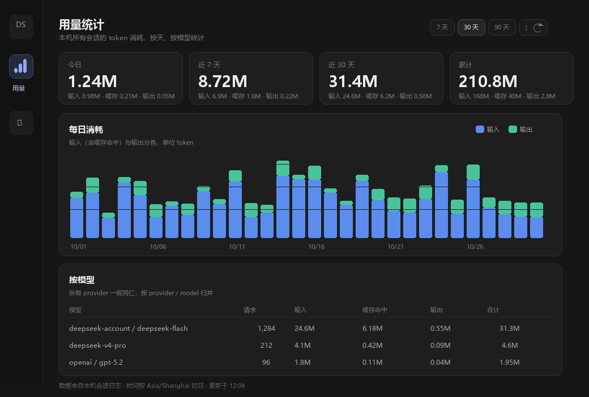

# DSH 插件集（dsh-plugins）

两个自用的 DeepSeek Harness 插件，目标是补上 Harness 默认没有的两件事：
**单次对话花了多少钱**、**本机每天/每个模型用了多少 token**。

> 适配版本：DeepSeek Harness `0.2.2-rc.1`（Desktop / Web 均可用）
> 数据全部留在本机，不上传任何 prompt、余额或用量。

| 插件 | 作用 | 出现位置 |
| --- | --- | --- |
| [`dsh-cost-meter`](dsh-cost-meter/README.md) | 当前会话的 token 速度与花费（按官方价目表实时估算） | 输入框右上方的胶囊 |
| [`dsh-usage-stats`](dsh-usage-stats/README.md) | 跨会话、按天、按 `provider/model` 的 token 账本 | 侧边栏「用量」面板 |



---

## 安装

两个包名都是 `@local/...`，不来自 npm，**必须从本地目录安装**。目录安装是软链：
装好后不要删除或移动仓库目录，否则 profile 里的依赖会失效。

1. 把仓库 clone 或解压到一台电脑上的固定位置，例如：

   ```text
   D:\DeepSeek\插件\dsh-cost-meter
   D:\DeepSeek\插件\dsh-usage-stats
   ```

2. 打开 Harness，新建会话，对 Agent 说：

   > 安装这两个本地插件（从目录安装）：
   > `D:\DeepSeek\插件\dsh-cost-meter`
   > `D:\DeepSeek\插件\dsh-usage-stats`

   Agent 会调用插件管理器的 `install_bundle`，两个都应返回 `application: applied`。

3. 刷新页面：侧边栏出现「用量」，输入框右上方出现花费胶囊。

> 换电脑的完整说明（含历史账本迁移）见 [docs/换电脑使用说明.md](docs/换电脑使用说明.md)。

## 从 Git 安装

```bash
git clone https://github.com/leiws-LTH/DeepSeek_Plugin.git dsh-plugins
```

然后按上面的方式，从 clone 出来的目录安装两个插件。之后更新只需要：

```bash
cd dsh-plugins
git pull
```

再在 Harness 里把对应 bundle 关闭后重新启用（或重装一次）并刷新页面。
Host 代码（`index.js`）的改动需要重载插件；Client 代码（`client.js`）在开发模式下可热更，
生产安装以重载/刷新为准。

---

## 插件一：dsh-cost-meter

在输入框右上方常驻一行 `42.5 tok/s · ≈¥0.0620`，点开是本轮/会话的用量、缓存命中率、
实时单价（高峰/空闲两档）、账户余额，以及本轮花费与会话累计。

- 价格表在 `client.js` 顶部的 `PRICES`，默认 `deepseek-flash`、`deepseek-v4-pro`，
  单位元/百万 token，空闲价是高峰价的一半。
- 节假日表 `HOLIDAYS` 目前为空：法定节假日会按工作日（高峰）计价，只会高估。
- 「本轮花费」按每个 step 完成时刻的单价累计，是精确值；
  「会话累计」用整段 token × **当前**时段单价，带 `≈`，是估算。
- 余额读取失败会降级成「读取失败 · 重试」，不影响胶囊显示。

详见 [`dsh-cost-meter/README.md`](dsh-cost-meter/README.md)。

## 插件二：dsh-usage-stats

侧边栏「用量」打开独立面板：今日 / 近 7 天 / 近 30 天 / 累计四张卡、每日柱状图、
按 `provider / model` 归并的明细表，支持 7/30/90/全部范围、刷新和重建。

数据来自会话日志的 `assistant/message.usage` 与 `request/header.config`，
由 Host 侧账本按天累计：

- 账本：`%DSH_HOME%\storages\usage-stats\ledger.json`（只存聚合数，不存消息内容）
- 启动时回填历史会话，运行中实时追加，2s 去抖原子落盘
- fork 会话只统计 `seq >= inheritedEventCount` 的己有事件，不重复计父会话用量
- 面板通过本机只读接口 `GET /usage-stats/summary` 读取；`POST /usage-stats/rebuild` 可重算

配置在 `dsh-usage-stats/cordis.patch.yml` 的 `config` 里：`timeZone`（默认 `Asia/Shanghai`）、
`backfill`、`flushDelayMs`、`concurrency`。

详见 [`dsh-usage-stats/README.md`](dsh-usage-stats/README.md)。

---

## 目录结构

```text
.
├─ dsh-cost-meter/           # 输入框花费胶囊
│  ├─ index.js               # Host 半（空实现，仅发布 bundle）
│  ├─ client.js              # 胶囊、面板、价目表、余额
│  ├─ cordis.patch.yml
│  ├─ locale/                # 插件管理页标题与描述
│  └─ icon.svg
├─ dsh-usage-stats/          # 用量统计面板
│  ├─ index.js               # Host 半：账本、回填、实时、HTTP 接口
│  ├─ client.js              # 侧边栏入口 + 统计面板
│  ├─ cordis.patch.yml       # 默认时区与回填开关
│  ├─ locale/
│  └─ icon.svg
├─ docs/                     # 设计稿、示意、换电脑说明
└─ README.md
```

## 配置与数据位置

| 内容 | 位置 |
| --- | --- |
| 单价表、节假日 | `dsh-cost-meter/client.js` 顶部的 `PRICES` / `HOLIDAYS` |
| 用量账本 | `%DSH_HOME%\storages\usage-stats\ledger.json` |
| 时区/回填配置 | `dsh-usage-stats/cordis.patch.yml` 的 `config` |
| 安装记录 | `%DSH_HOME%\profiles\<profile>\package.json` 的 `dsh.profile.bundles` |

`DSH_HOME` 默认是 `C:\Users\<用户名>\.dsh`。

## 更新与卸载

- **更新**：`git pull` 后，在 设置 → 插件 里关闭再启用对应 bundle，或先 `remove_bundle` 再
  `install_bundle`，然后刷新页面。
- **卸载**：先让 Agent 执行 `remove_bundle`（或设置里移除），成功后再删除目录。
  直接删目录会让 profile 残留一个失效的软链依赖。

## 兼容性与已知限制

- 针对 `0.2.2-rc.1` 开发，使用了会话投影、`conversation.input.dock`、`sidebar.panellist`、`main`、
  `webServer`、`sessionQuery`、`session/event` 等接口；Harness 大版本升级后可能需要适配。
- 两个插件都没有声明 `engines.dsh`，安装不会被版本检查拦住，但跨版本不保证行为。
- `dsh-cost-meter` 的「会话累计」是估算；`dsh-usage-stats` 只统计经过本机 Harness 的调用。
- 用量账本是本机文件，不会云端同步；两台电脑的账本可以手动合并。

## 开发

- 插件是普通 JavaScript（无构建步骤）：Host 用 ESM，Client 用 `window.__ModuleLoader__.load({...})`。
- 改完先做语法检查：`node --check dsh-cost-meter/client.js`（Node 18+ 即可）。
- 发布前在 Harness 里实际安装一次，确认 `application: applied` 且界面可见。
- 设计取舍见 [docs/设计-用量计费插件.md](docs/设计-用量计费插件.md) 与
  [docs/设计-用量统计面板.md](docs/设计-用量统计面板.md)。

## 变更记录

见 [CHANGELOG.md](CHANGELOG.md)。

## 许可证

个人项目，暂未指定开源许可证；如需公开发布请先补充 `LICENSE`。
