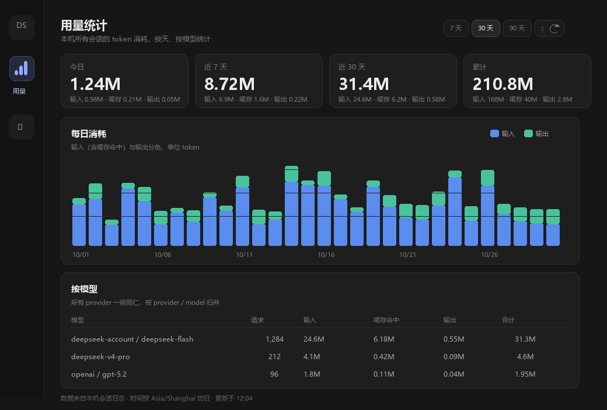

# 用量统计面板（dsh-usage-stats）设计

> 目标版本：DeepSeek Harness 0.2.2-rc.1（当前 profile: desktop）
> 状态：设计稿，待确认后实施
> 与现有插件的关系：独立新插件；输入框那颗胶囊是"单会话花钱多少"，这个是"按天、按模型的 token 账本"

---

## 1. 我对需求的理解

你要的不是再一个"当前会话花了多少"的浮层，而是**一本账**：

1. 一个**独立面板**，在应用里直接打开，不用跳转到网页；
2. 按**天**记录 token 用量，能看今天、最近 7/30 天、累计；
3. **所有模型一视同仁**：官方账号模型、自己接的 API key、其他 provider，只要经过 Harness 发请求都算；
4. 只看 **token 消耗量**，先不做金额；
5. 简单清晰，能看出"哪天用得多、哪个模型占大头"。

现状的问题：官方用量页只覆盖 DeepSeek 账号下的调用；第三方 API 的账单在各自平台；Harness 自己的统计只到单会话。三处拼不起来，所以需要在本机做一份统一账本。



---

## 2. 数据从哪来（这也是能做"跨模型"的原因）

Harness 把每次模型调用都写进了会话日志，事件结构正好够用：

| 事件 | 内容 | 用途 |
| --- | --- | --- |
| `request/header` | `data.header.config.{provider, model}` | 这次请求走的是哪个 provider / 模型 |
| `assistant/message` | `data.usage.{inputTokens, outputTokens, cacheReadTokens, cacheWriteTokens}`，`data.turn/step`，事件 `time` | 一次计费尝试的实际用量与发生时间 |

因此：

- 统计口径是**"经过本机 Harness 的调用"**，与 provider 无关；官方 `deepseek-account`、API key 路由、pi-ai 接的其他模型，一视同仁。
- **不经过 Harness 的调用统计不到**（比如你在别的客户端直接调 API），这是本方案的边界，面板页脚会写明。
- 历史会话也在本机日志里，所以**装插件之前的用量可以回填**，不用从零开始。

---

## 3. 为什么不能只用现成的东西

| 现成能力 | 为什么不够 |
| --- | --- |
| 会话投影 `tokenUsage` | 只有"这个会话总共多少"，没有日期、没有模型维度，也不跨会话 |
| `sessionStats` | 同样是单会话 |
| 官方用量网页 | 只覆盖 DeepSeek 账号，第三方 API 不在里面 |
| 输入框胶囊（cost-meter） | 单会话、带价格估算，不是账本 |

所以需要一个**跨会话的日粒度聚合器**，在 Host 侧做，结果给面板读。

---

## 4. 架构

```text
                 Host（主进程）                          Client（浏览器）
┌──────────────────────────────────────────┐   ┌───────────────────────────┐
│ UsageLedger                              │   │ sidebar.panellist         │
│  ├ 启动回填：listSessions → readSession   │   │   └ id: usage-stats（图标）│
│  ├ 实时追加：on('session/event')          │   │ main（keyed）             │
│  └ 落盘：$DSH_HOME/storages/…/ledger.json │   │   └ key: usage-stats（页面）│
│                                          │   │                           │
│ HTTP（只读）                              │◄──┤ fetch(/usage-stats/summary)│
│  GET /usage-stats/summary?days=30        │   │  面板：卡片/柱图/模型表    │
└──────────────────────────────────────────┘   └───────────────────────────┘
```

为什么用一条本机 HTTP 路由做 Host→Client 的桥：

- 手写插件**无法新增 Remote 命名空间**——`ctx.remote.*` 是构建期生成并固定在装配里的；
- 会话投影是**按会话**的，装不下全局账本；
- 本机回环 HTTP 路由是 webserver 公开的注册点，只读、同源、无 CORS 头，浏览器以外的来源读不到跨域响应。

> 实现时用 `ctx.webServer.register({ kind: 'exact', path: '/usage-stats/summary', resource })`，
> `resource` 只接受 GET/HEAD，返回 `Response`。
>
> 已在本机确认：桌面窗口的页面 origin 是 `dsh-app://app`（自定义 scheme），但相对路径
> `fetch('/usage-stats/summary')` 会被 Desktop 的协议处理器转给同一个 Host webserver，实测能拿到 JSON；
> 因此面板不需要知道端口，也不经过跨域。若某个载体没有这层转发，面板会显示"统计服务不可用"，
> 而不是静默空白。

**备选方案（已放弃）**：客户端用现成的 `ctx.remote.session.events()` 翻页读取所有会话、在浏览器里聚合。
缺点是第一次打开要把全部会话事件（含完整消息和工具结果）下载到页面，历史一大就不可用；
Host 侧账本只读日志、只写聚合数，打开面板时是一条几百 KB 的 JSON，代价低一个数量级。

---

## 5. 归因规则（口径要一次说清）

| 项 | 规则 |
| --- | --- |
| 计一次 | 每条带合法 `usage` 的 `assistant/message` 计 1 次请求；重试如果各自落了消息，也各算各的 |
| 四个桶 | `in` = 未缓存输入；`cr` = 缓存读取；`cw` = 缓存写入；`out` = 输出（含推理 token） |
| 合计 | `total = in + cr + cw + out` |
| 模型 | 同会话最近一条 `request/header` 的 `provider/model`；缺失记 `unknown/unknown` |
| 日期 | `event.time` 按配置时区切日（默认 `Asia/Shanghai`），不用本机随意的 locale |
| **fork 继承** | fork 会把父会话的历史事件复制到自己的日志头部；`readSession` 返回的 `inheritedEventCount` 就是这段前缀。**只统计 `seq >= inheritedEventCount` 的己有事件**，否则父会话的用量会被子会话重复计一遍 |
| 子代理 / 后台任务 | 它们各自是会话，自然计入 |
| 压缩摘要 | 是真实的模型调用，计入（这也是账本比"聊天字数"高的原因） |
| 失败/中断 | 没有落成 `assistant/message` 的尝试在日志里没有 usage，统计不到（系统仍可能已计费）；有 usage 的照计 |
| 厂商差异 | 某些 provider 不回报缓存字段 → 按 0 处理，不估算 |

---

## 6. 存储与增量（这是能不能长期用的关键）

### 6.1 账本文件

`%DSH_HOME%\storages\usage-stats\ledger.json`（当前即 `C:\Users\Administrator\.dsh\storages\usage-stats\ledger.json`）

```json
{
  "version": 1,
  "timeZone": "Asia/Shanghai",
  "updatedAt": 1793930000000,
  "days": {
    "2026-11-06": {
      "req": 1284,
      "in": 24600000, "cr": 6180000, "cw": 0, "out": 550000,
      "models": {
        "deepseek-account/deepseek-flash": { "req": 1200, "in": 24000000, "cr": 6180000, "cw": 0, "out": 540000 }
      }
    }
  },
  "sessions": {
    "<sessionId>": { "seq": 1790, "inherited": 0, "rev": "1730000000000:482913", "route": "deepseek-account/deepseek-flash" }
  }
}
```

- **只存聚合数，不存事件**，一年几十 MB 的日志也只对应几十 KB 账本。
- 写入：临时文件 + `rename` 原子替换；变更后 2s 去抖；`turn/end` 与插件卸载时强制 flush。
- 账本是**派生缓存**：丢了可以重建（见 6.4），会话日志才是事实来源。

### 6.2 启动回填（一次，异步）

1. `ctx.sessionQuery.listSessions()` 拿全部会话（含归档、子代理会话）；
2. 对每个会话用 `ctx.sessionPersistence.stat(id).revision` 和账本里的 `rev` 比较；
   - 相同 → 跳过（几乎零成本）；
   - 不同 / 新会话 → `ctx.sessionQuery.readSession(id)` 读完整日志；
3. 只折叠 `seq >= inheritedEventCount` 且 `seq > sessions[id].seq` 的**己有**事件（会话日志只追加），不重复计数；
4. 更新 `seq`、`inherited`、`rev`、`route`。

当前语料只有 10 个会话 / 4.8MB，回填是毫秒级；以后变大事先比较 revision，只读变化过的会话。回填期间面板显示"正在统计 3/10"。

`sessionPersistence` 在装配里是可选服务：取不到 `stat()` 时退化为"每次启动都读一遍全部会话"（当前规模无感）；
`sessionQuery` 是必需依赖，缺失时插件保持不激活并写一条日志。

### 6.3 实时追加

`ctx.on('session/event', (session, event) => …)`：

- `request/header` → 记下该会话当前 route；
- `assistant/message` → 按 `event.time` 的日期与 route 累加到账本，`seq = event.seq`；
- 所有变更走同一个去抖落盘。

回填与实时可能撞车：按会话加一把内存锁，回填中的会话先把实时事件排队，回填完再按 seq 补，避免重复。

### 6.4 重建

面板上的"重建"触发全量重扫（`POST /usage-stats/rebuild`，GET 兜底）：先算到临时账本，成功后再替换。
用于：时区改了、schema 升级、日志修复、怀疑账本不准。

---

## 7. 面板设计

### 7.1 位置与入口

- 侧边栏全局面板列表（`sidebar.panellist`）新增一行：**用量**，`order: 20`（插件 0、自动化任务 10 之后）；
- 对应 `main` 面板 `key: 'usage-stats'`，点击图标 `ctx.layout.selectPanel('usage-stats')` 切换；
- 图标：柱状图 + 小圆点（原创 SVG），选中态跟随侧边栏高亮。

### 7.2 页面结构

```text
用量统计                                    [7天][30天][90天][全部]  ⟳
本机所有会话的 token 消耗，按天、按模型统计

┌ 今日 ────────┐ ┌ 近 7 天 ─────┐ ┌ 近 30 天 ────┐ ┌ 累计 ────────┐
│ 1.24M        │ │ 8.72M        │ │ 31.4M        │ │ 210.8M       │
│ 输入·缓存·输出│ │ …            │ │ …            │ │ …            │
└──────────────┘ └──────────────┘ └──────────────┘ └──────────────┘

每日消耗                                  ■ 输入  ■ 输出
[30 根柱子，悬停显示当天四个桶与请求数]
10/08        10/13        10/18        10/23        10/28

按模型                    所有 provider 一视同仁，按 provider / model 归并
模型                              请求     输入     缓存命中   输出     合计
deepseek-account / deepseek-flash 1,284   24.6M    6.18M     0.55M   31.3M
deepseek-v4-pro                    212     4.1M     0.42M     0.09M    4.6M
openai / gpt-5.2                    96      1.8M     0.11M     0.04M    1.95M

数据来自本机会话日志 · 按 Asia/Shanghai 切日 · 更新于 12:04
```

- 范围切换是**纯前端重算**，不重新扫日志（数据一次拉全量日粒度，切换只过滤）；
- 刷新按钮重新拉取；面板处于激活状态时每 10s 自动刷新一次（页面不可见时暂停）；
- 空态：没有数据时给一句"还没有用量记录，发一条消息就会开始统计"；
- 数字格式：`1,284`、`1.24M`、`31.4K`，保留 1 位小数；表格里给精确值 + 千分位；
- 表格按合计降序，最后一列带占比条；模型名过长时省略，悬停看全名。

### 7.3 视觉

沿用宿主：`--dsw-alias-bg-base` 背景、`--dsw-alias-border-l1` 分隔、卡片 `--dsw-radius-lg`、
标题 15px/500、正文 12px、数字 `tabular-nums`；柱状图两色（输入蓝、输出绿），不引入图表库。

---

## 8. 接口

`GET /usage-stats/summary?days=30`

```json
{
  "generatedAt": 1793930000000,
  "timeZone": "Asia/Shanghai",
  "today": "2026-11-06",
  "status": "ready",              // ready | scanning
  "progress": { "done": 10, "total": 10 },
  "totals": {
    "today":  { "req": 1284, "in": 24600000, "cr": 6180000, "cw": 0, "out": 550000 },
    "last7":  { "…": 0 },
    "last30": { "…": 0 },
    "all":    { "…": 0 }
  },
  "days": [
    { "date": "2026-10-08", "req": 212, "in": 4100000, "cr": 420000, "cw": 0, "out": 90000 }
  ],
  "models": [
    { "key": "deepseek-account/deepseek-flash", "req": 1284, "in": 24600000, "cr": 6180000, "cw": 0, "out": 550000, "total": 31350000 }
  ],
  "updatedAt": 1793929000000
}
```

- `days` / `models` 由 `?days=` 决定窗口；`totals` 始终给四个固定口径；
- 响应头：`content-type: application/json`、`cache-control: no-store`；
- 只读、无 `Access-Control-Allow-Origin`，跨站页面读不到；
- 服务端不返回会话标题、内容或任何 prompt 文本，只有数字与 `provider/model`。

---

## 9. 插件结构

```
D:\DeepSeek\插件\dsh-usage-stats\
├─ package.json          # @local/dsh-usage-stats，dsh.bundle + dsh.client
├─ cordis.patch.yml      # insert 一行 host 插件
├─ index.js              # Host：Config、ledger、回填/实时、HTTP 路由
├─ client.js             # Client：侧边栏图标 + 面板页
├─ locale/zh.json,en.json
├─ icon.svg
└─ README.md
```

Host `Config`：

| 字段 | 默认 | 说明 |
| --- | --- | --- |
| `timeZone` | 系统时区 | 切日用的 IANA 时区，默认建议 `Asia/Shanghai` |
| `backfill` | `true` | 启动时回填历史会话 |
| `flushDelayMs` | `2000` | 落盘去抖 |
| `liveRefresh` | `true` | 实时追加 |

Client 端注册：

- `ctx.locale.register('usageStats', { zh, en })`
- `ctx.slots.inject('sidebar.panellist', () => register({ id: 'usage-stats', order: 20, label, locale }))`
- `ctx.slots.inject('main', () => register({ key: 'usage-stats', locale }, UsagePage))`
- 图标组件接收 `{ size, active }`，画 16×16 柱状图。

安装与验证：

1. `install_bundle`（绝对目录）→ `application: applied`；
2. `Slots.listSubTree('sidebar.panellist')` 出现 `usage-stats` 且 `active: true`；
3. 刷新页面看到入口，打开面板有数字；
4. 用另一个 provider 发一条消息，表格出现第二行；
5. 重启应用，数字不变（账本持久化）；
6. 对比当前会话：面板"今日" ≥ 该会话 `tokenUsage` 合计（应包含历史会话）。

---

## 10. 边界与风险

| 场景 | 处理 |
| --- | --- |
| 不经过 Harness 的 API 调用 | 统计不到；页脚明确写"仅统计本机 Harness 发起的调用" |
| 插件安装前的历史 | 默认回填；日志还在就能算出来 |
| 删除会话 | 账本保留历史（用量确实发生过）；重建时会以现存日志为准，删掉的会消失 |
| 修改时区 | 需要点"重建"重新切日；否则跨日边界会错 |
| 日志格式迁移 / 被重写 | `seq` 对不上时跳过该会话并提示重建，不硬算 |
| fork 继承 | 只算己有事件（`seq >= inheritedEventCount`），否则父会话用量会被重复计 |
| 首次回填大历史 | 异步 + 进度；只读变化过的会话，日常启动几乎零成本 |
| 多客户端 | 桌面单实例；账本单写者（Host）。若将来多开，需要加文件锁 |
| provider 不报缓存 | `cr/cw` 记 0，不估算 |
| 隐私 | 只写本机文件；接口只返回数字；HTTP 只读、无 CORS、服务只监听回环 |

---

## 11. 分期与验收

**P1（本次）**
- Host：ledger + 启动回填 + 实时追加 + 原子落盘 + `/usage-stats/summary`
- Client：侧边栏入口 + 面板（汇总卡、30 天柱图、按模型表、范围切换、刷新）
- 验收：上面"安装与验证"6 条全部通过

**P2（可选）**
- 按会话明细（会话标题 + token + 模型），支持排序
- 导出 CSV
- 复用 cost-meter 价格表，增加"金额"列（同一账本，不需要新数据）
- 90 天以上按周/月聚合视图

---

## 12. 需要你确认

1. **入口**：侧边栏"插件 / 自动化任务"下面加"用量"，点击进独立面板（推荐）；还是做成设置里的一个页面？
2. **时区**：默认 `Asia/Shanghai` 切日，可以吗？
3. **范围**：`7 天 / 30 天 / 90 天 / 全部` 够用吗？
4. **历史回填**：默认把装插件之前的会话也算进去（推荐），还是只从安装后开始？
5. **表格维度**：先按"模型"汇总就够，还是也要"按会话"榜（P2）？

确认后按第 9 节开工，先交付一个能看到真实数字的 P1。

---

## 13. 实施记录（2026-11-06）

P1 已交付并装上当前 profile：

- 包：`D:\DeepSeek\插件\dsh-usage-stats`（`@local/dsh-usage-stats` 1.0.0），已进入 `dsh.profile.bundles`；
- 注册：`sidebar.panellist` → `id: usage-stats`（order 20，active），`main` → `key: usage-stats`（active）；
- 账本：`C:\Users\Administrator\.dsh\storages\usage-stats\ledger.json`，首扫 10 个会话；
- 接口：`GET /usage-stats/summary`、`POST /usage-stats/rebuild` 均返回正常；
- 实测数字：全量 155M / 727 次，按 `deepseek-account/deepseek-flash` 单模型；与本机日志直接求和一致
  （直接求和 138.8M / 695 次时，面板 138.3M / 694 次，差一条刚落账的消息，说明实时追加正常）；
- 重建：POST 后账本重算，数字不回退、不翻倍；
- 重启：改 host 代码触发插件重载后，数字从 154.65M 连续增长到 155.2M，没有重复累计；
- 面板：浅色主题下截图确认汇总卡、柱图、模型表、页脚均正常。

实施中修掉的问题：

1. **页面 origin 是 `dsh-app://app`，不是 http**：最初按"非 http 就报错"处理，面板直接显示不可用；
   实测相对路径 `fetch` 会被 Desktop 协议处理器转给 Host webserver，去掉协议判断后正常。
2. **主题令牌名写错**：卡片/面板用了不存在的 `--dsw-alias-bg-l1`、`--dsw-alias-label-tertiary`，
   在浅色主题下退化成深色卡片。改用 Theme 列出的 `--dsw-alias-bg-layer-1/2`、
   `--dsw-alias-label-primary/secondary`、`--dsw-alias-border-l1/l2`、`--dsw-alias-brand-primary`。
3. **回填与实时撞车会漏计**：启动早期的事件可能在会话回填前先落地，把 `seq` 推高后回填会跳过更早的己有事件；
   现在在首次扫描完成前把所有实时事件按会话缓存，扫描结束后再按 `seq` 补放并去重。
4. **账本序列化**去掉临时的 `backfilled` 标记，避免重启后把"未回填"状态写进文件。

尚未做（P2）：

- 按会话明细、CSV 导出、金额列、周/月聚合；
- 浏览器内"重建统计"按钮的点击链路未单独点选验证；Host 端 `POST /rebuild` 已验证，
  客户端做了 `POST → GET` 兜底（GET 入口在下次 Host 重启后生效）。
- 首次回填的进度只在扫描期间显示，大语料下尚无逐会话进度条。

