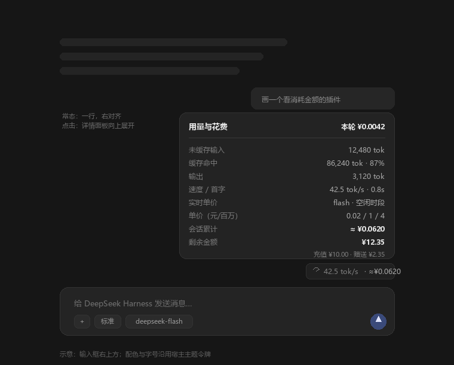

# 用量计费插件（dsh-cost-meter）设计

> 目标版本：DeepSeek Harness 0.2.2-rc.1（当前 profile: desktop）
> 状态：设计稿，待确认后实施

---

## 1. 我对需求的理解

现在输入框下方已经有两颗统计胶囊（`activity`：轮数/步数/速度/TTFT；`usage`：token 总量/缓存命中），
数据来自宿主投影 `sessionStats` 与 `tokenUsage`。问题不是"没有数据"，而是**只有 token，没有钱**，
而且它们位于输入框**下方**、信息密度低，需要点开才知道细节。

你要的是：

1. **位置**：输入框**右上方**，常驻一行，不打扰写作；
2. **折叠态**：一眼可读，比如 `42.5 tok/s · ≈¥0.0620`；
3. **展开态**：每轮提问后能看到完整参数
   - token 速度
   - 输入 token（未缓存 / 缓存读取 / 缓存写入）
   - 输出 token
   - 缓存命中率
   - **实时单价**（当前时段、当前模型的每百万 token 价格）
   - **剩余金额**（账户余额）
   - 以及由这些推出的**本轮花费 / 会话累计花费**
4. 重启、切会话后仍然在，数据不丢。



---

## 2. 现状核查：上次为什么"没有出现"

这是设计前必须先说清的事实，否则同样的坑会再踩一次。

| 检查项 | 现状 | 含义 |
| --- | --- | --- |
| 工作区 `D:\DeepSeek\插件` | **空目录** | 上次的插件源码已被删除 |
| profile `package.json` | 有 `@local/dsh-cost-meter: link:...` 依赖，但 `dsh.profile.bundles` 里**没有它** | bundle 选择未完成；链接还指向空目录 |
| profile `cordis.patch.yml` | **没有** cost-meter 的 `insert` 行 | 即使目录存在，Loader 也不会加载它 |

结论：这已经不是"渲染不出来"，而是**插件根本没被组合进当前 profile**。
所以第 0 步不是改样式，而是先把源码目录和 patch 行补齐（本地目录安装是软链，profile 里同名的依赖会随之重新指向），
并且这次把"slot 里确实出现占用者 + 页面上确实看到"写进验收，而不是只看安装日志。

---

## 3. 宿主已经提供的能力（直接复用，不重造）

| 需要的数据 | 来源 | 形态 |
| --- | --- | --- |
| token 用量（全会话、含压缩/重试） | Client 投影 `tokenUsage` | `{ uncachedInputTokens, cacheReadTokens, cacheWriteTokens, outputTokens }` |
| 速度、TTFT、模型/工具耗时 | Client 投影 `sessionStats` | `{ turns, steps, llmMs, toolMs, ttftMs, ttftSteps, decodeMs, decodeTokens }` |
| 本轮逐节点明细 | `useChat((s) => s.legacy.nodes)` | 每个 assistant 节点带 `usage`（与 `tokenUsage` 同名的用量桶，宿主"本轮用量"面板就读它）与 `timing`（stepStartTime / firstTokenTime / completedTime） |
| 当前模型 | 投影 `modelSelection` | `{ next?, lastUsed? } → { provider, model, reasoningEffort }` |
| 账户余额 | Client Remote `ctx.remote.account.getBalance(meta)` | `{ ok, value: { status: 'ready', value: Wallet[], bonusWallets: Wallet[] } }`，`Wallet = { currency, balance }`（金额是十进制字符串） |
| 价格 | 官方价格表（见 §5） | 需插件自建价格表，宿主不提供 |

已验证的 slot（`cordis_inspect_query` → `Slots.listSubTree`）：

- `conversation.input.dock`：**输入框卡片上方的整行区域**，当前占用者 `todo`(0)、`goal`(10)、`queue`(20)；
  容器是 `flex-direction: column; gap: 6px`，子项默认撑满宽度。
- `conversation.composer.dock`：输入框**下方**，宿主两颗统计胶囊就在这里；
- `conversation.input.overlay`：卡片内部浮动层（会压字，不选）；
- `conversation.input.right`：底部按钮行（不是"右上方"，不选）。

---

## 4. 位置与交互设计

### 4.1 位置

用 `conversation.input.dock`，`id: "cost"`、`order: 30`（排在 goal/queue 之后），
外层 `div` 设 `display:flex; justify-content:flex-end`，胶囊右对齐——
视觉上正好落在**输入框卡片的右上角上沿**，与输入框右边界对齐。

```text
┌──────────────────────────────────────────────┐
│  ……对话……                                     │
│                                              │
│                       ⏱ 42.5 tok/s · ≈¥0.0620 │ ← 常驻胶囊（本插件）
│  ┌────────────────────────────────────────┐  │
│  │ 给 DeepSeek Harness 发送消息…           │  │
│  │ ＋  标准  deepseek-flash          ➤     │  │
│  └────────────────────────────────────────┘  │
│         （宿主原有 activity / usage 两颗胶囊） │
└──────────────────────────────────────────────┘
```

选择理由：
- slot 已分配空间，不覆盖、不挤压输入区；
- 右对齐后与输入框右边缘重合，符合"输入框右上方"；
- 该 slot 只在有会话时渲染，新建空白页不会出现"空胶囊"。

### 4.2 折叠态

| 状态 | 显示 |
| --- | --- |
| 有数据 | `⏱ 42.5 tok/s · ≈¥0.0620`（金额是**会话累计**） |
| 正在生成 | 数字每秒刷新，速度是流式估算（带 `≈`） |
| 尚无任何用量 | `⏱ — · ≈¥0.0000` |
| 价格表缺该模型 | 只显示速度与 token，金额位置显示 `—`，面板写明"该模型未配置价目" |

金额单位：`¥`；小于 0.01 显示 `¥0.00xx`，否则两位小数；超过 1 元显示 `¥1.23`。
速度：一位小数；`decodeMs` 为 0 时不显示。
hover 提示给出完整读数：`本轮 ¥0.0042 · 会话 ¥0.0620 · 47.2 tok/s`。

### 4.3 展开态

点击胶囊 → 面板**向上**弹出（`position: fixed` + portal 到 `body`，因为输入区会裁剪溢出），
右边缘与胶囊右边缘对齐，宽度 `min(340px, 100vw - 24px)`，最大高度受限可滚动。

- `Esc`、点击面板外、再次点击胶囊 → 关闭；
- 胶囊 `aria-expanded`、`aria-haspopup="dialog"`，面板 `role="dialog"` 且带标题；
- 打开时焦点不强制移动（与宿主统计胶囊一致），键盘用户可 Tab 进入；
- 面板内容：

```text
用量与花费                         本轮 ≈¥0.0042
─────────────────────────────────────────────
未缓存输入        12,480 tok
缓存命中          86,240 tok · 87%
输出               3,120 tok
速度 / 首字       42.5 tok/s · 0.8s
本轮花费          ≈ ¥0.0042
会话累计          ≈ ¥0.0620
─────────────────────────────────────────────
实时单价          deepseek-flash · 空闲时段
  命中 / 未命中 / 输出   0.02 / 1 / 4 元/百万
  下一次切换        次日 09:00 进入高峰（×2）
剩余金额          ¥12.35
  充值 ¥10.00 · 赠送 ¥2.35       更新于 22:30
```

设计细节：
- "本轮"用当前 turn 的 assistant 节点精确累加（含工具多步）；"会话累计"用投影；
- `≈` 只出现在"按当前单价折算"的数字上；二期切到精确投影后去掉；
- 余额是**平台侧**数值，与本地累计成本不保证同源同步，标"更新于 HH:mm"；
- 面板底部留一行淡色说明：`按官方价目表本地计算，最终以平台账单为准`。

### 4.4 视觉规范（沿用宿主）

复制宿主统计胶囊的度量，类名改前缀，避免任何宿主 CSS 依赖：

| 项 | 值 |
| --- | --- |
| 字号 | `calc(var(--dsh-content-font-size-secondary, 13px) - 1px)` |
| 行高 | `calc(20px + var(--dsh-content-font-delta-secondary, 0px))` |
| 文字色 | `var(--dsw-alias-label-tertiary)`，hover `var(--dsw-alias-label-secondary)` |
| 内边距 / 圆角 | `1px 8px` / `var(--dsw-radius-sm)` |
| hover 背景 | `var(--dsw-alias-interactive-bg-hover)` |
| 数字 | `font-variant-numeric: tabular-nums`（避免跳动） |
| 面板 | `var(--dsw-specific-menu)` + `var(--dsw-elevation-prominent)` + `var(--dsw-radius-lg)` |

---

## 5. 指标口径与计价公式

### 5.1 口径

| 指标 | 计算 |
| --- | --- |
| 计费输入 | `uncachedInputTokens + cacheReadTokens + cacheWriteTokens` |
| 输出 | `outputTokens`（含推理 token） |
| 缓存命中率 | `cacheReadTokens / 计费输入`（无输入时为 `—`） |
| 速度 | `decodeTokens / decodeMs × 1000`（tok/s） |
| 首字延迟 | `ttftMs / ttftSteps`（有样本时） |

"本轮"= 当前最大 turn 的所有 assistant 节点求和；节点缺 `usage` 时该轮金额显示 `—`，不猜。

### 5.2 计价

```text
cost = ( miss × P_miss + hit × P_hit + write × P_miss ) / 1e6
     + output × P_out / 1e6
```

- 缓存写入按**未命中**价计（官方价目表只有"命中/未命中"两档）；
- 价格表按"模型 × 时段"存，单位：元 / 百万 tokens；
- 每次请求按其**完成时刻**所在时段计价，而不是按当前时刻重算整段历史（二期）；
- 一期由于只有聚合 token，使用**当前时段单价**折算并在金额前加 `≈`。

### 5.3 官方价格（2026-11 抓取，元 / 百万 tokens）

| 模型 | 输入·缓存命中（空闲/高峰） | 输入·未命中（空闲/高峰） | 输出（空闲/高峰） |
| --- | --- | --- | --- |
| `deepseek-flash` | 0.02 / 0.04 | 1 / 2 | 4 / 8 |
| `deepseek-v4-pro` | 0.15 / 0.30 | 4.5 / 9 | 13.5 / 27 |

- 空闲价 = 高峰价的一半；
- 高峰：**北京时间**周一至周五 9:00–12:00、14:00–18:00（中国法定节假日除外）；
- 其余时间（含周末、节假日全天）为空闲。

来源：[模型 & 价格（官方文档）](https://api-docs.deepseek.com/zh-cn/quick_start/pricing/)。

实现要点：
- 时区固定 `Asia/Shanghai`，不跟随系统时区；
- 内置 2026 年法定节假日表（可配置），未知日期按"工作日"处理（宁可高估，不低估）；
- 每分钟刷新一次"当前时段"，面板展示下一次切换时间；
- 模型 id 归一到价格表键：`deepseek-flash`、`deepseek-v4-pro`；未知模型 → 不显示金额并在面板说明。

---

## 6. 剩余金额（余额）

- 调用：`ctx.remote.account.getBalance({ version, locale, timezoneOffsetSeconds })`
  （`version` 用与当前构建一致的字面量，默认 `0.2.2-rc.1`；升级 Harness 时同步即可，平台只把它当客户端元数据）；
- 返回 `status: 'ready'` 时取 `value[]`（充值余额）与 `bonusWallets[]`（赠送余额），
  按 `currency` 分组；主数字显示**同币种合计**，副行拆分"充值 / 赠送"；
- 非 CNY 钱包：主数字照常显示该币种，价格表另配 `currency`，不混算；
- 刷新时机：打开面板、每轮结束、窗口重新获得焦点，且 **30s 节流**；
- 失败降级：保留上次值并标注时间；从未成功过则显示 `—` 并在面板给一行"余额读取失败，点击重试"；
- 未登录 / 无 `account/watch` 权限：整个余额区块隐藏（不显示占位错误）；
- 平台余额与本地累计成本不保证相等（充值、赠送、其他客户端消费），面板注明"平台余额，仅供参考"。

---

## 7. 架构与分期

### 7.1 一期：纯 Client 插件（先让它出现）

```
conversation.input.dock  (slot)
        │
        ▼
   CostPill (React)
   ├─ useProjection('tokenUsage')      → 会话 token
   ├─ useProjection('sessionStats')    → 速度 / TTFT
   ├─ useProjection('modelSelection')  → 当前模型
   ├─ useChat(s => s.legacy.nodes)     → 本轮节点、流式估算
   └─ ctx.remote.account.getBalance()  → 余额
        │
        ▼
   CostPanel（portal 面板，明细行）
```

- 宿主侧 `apply()` 为空（与模板一致），全部逻辑在 `client.js`；
- 价格表是 `client.js` 顶部的 `PRICES` 常量（客户端半是脚本模块，不要拆成第二个文件再相对导入），改价改这里；
- 金额带 `≈`，口径在面板里说明；
- 优点：无新投影 key、无新 Remote，风险最低，最快能在界面上看到；
- 缺点：会话跨时段/跨模型时是估算；改价需改代码。

### 7.2 二期：Host 投影 `costMeter`（精确）

新增一个 session projection unit，客户端零改动：

```
Host: ctx.sessionProjections.register({
  key: 'costMeter',
  stateVersion: 1,
  init: () => empty,
  apply(state, event) {
    // request/header → 记录本次 route(provider/model)
    // assistant/message → 用 message.time 所在时段 + route 价目，累加 cost / tokens
    // turn/start / turn/end → 维护本轮窗口
  },
  wire: { viewSchema, view: s => ({...}) },   // 客户端可见
})
Client: useProjection('costMeter')
```

- 按**每次请求发生时刻**的价目计价，切模型、跨高峰都不再失真；
- 状态是纯 JSON、可 checkpoint，冷启动只回放尾部；
- 价格表放进插件 `Config`（`cordis.patch.yml` 可改），保留 `effectiveFrom` 以支持调价历史；
- 需要先验证：自定义 key（不在 `SessionProjectionMap` 中）+ `wire.view` 能否被客户端 `useProjection` 读到；
  若不通，退化为 Host `ctx.on('session/event')` + 自定义 Remote（成本高，不优先）。

**建议**：一期先交付可用的胶囊与面板（1–2 天内可见），确认位置和文案后再做二期精算。

---

## 8. 插件文件结构

```
D:\DeepSeek\插件\dsh-cost-meter\
├─ package.json          # name: @local/dsh-cost-meter, dsh.bundle + dsh.client
├─ cordis.patch.yml      # insert 一行 host 插件（一期 apply 为空）
├─ index.js              # Host 半：export function apply() {}
├─ client.js             # Client 半：slot 注册 + 胶囊 + 面板 + 计价 + 内联价目表
├─ locale/
│  ├─ zh.json            # Plugin Manager 元数据：meta.title / meta.description
│  └─ en.json
└─ icon.svg              # 插件管理页图标（原创：¥ + 用量波形）
```

> 面板内的界面文案用 `ctx.locale.register('usageCost', { zh, en })` 内联注册，不必和 `locale/*.json` 共用；
> `locale/*.json` 只服务插件管理页的标题与描述。

`package.json` 关键字段：

```json
{
  "name": "@local/dsh-cost-meter",
  "version": "1.0.0",
  "private": true,
  "type": "module",
  "exports": {
    ".": "./index.js",
    "./client": "./client.js",
    "./locale/*.json": "./locale/*.json",
    "./icon": "./icon.svg"
  },
  "files": ["index.js", "client.js", "cordis.patch.yml", "locale/*.json", "icon.svg"],
  "dsh": {
    "bundle": { "patch": "./cordis.patch.yml" },
    "client": {
      "platform": "web",
      "immediately": true,
      "inject": [
        "@deepseek-ai/dsh-api-remotes",
        "@deepseek-ai/dsh-client-locale",
        "@deepseek-ai/dsh-client-ui-conversation"
      ]
    }
  }
}
```

`cordis.patch.yml`：

```yaml
- insert:
    - id: cost-meter
      name: '@local/dsh-cost-meter'
```

`client.js` 注册骨架：

```js
window.__ModuleLoader__.load({
  id: '@local/dsh-cost-meter',
  factory(require) {
    const React = require('react')
    // ...
    return {
      inject: ['slots', 'locale', 'remote', 'remote.account'],
      apply(ctx) {
        ctx.slots.inject('conversation.input.dock', () => ctx.slots.register({
          name: 'conversation.input.dock',
          id: 'cost',
          order: 30,
          locale: 'usageCost',
        }, CostDock))
      },
    }
  },
})
```

安装与验证：

0. 先在 `D:\DeepSeek\插件\dsh-cost-meter\` 重建源码目录（本地目录安装是**软链**，profile 仍记着这个名字，
   装新包会顺带把依赖指向它）；若安装器报"已安装/ENOENT"，先 `list_plugins` 找到该项 `remove_bundle` 再装；
1. `plugin_manager` → `install_bundle`，`target` 传上面目录的绝对路径；
2. 读返回值：`application: applied` 才算生效（不看日志/进程）；
3. 刷新页面，用 `Slots.listSubTree(root: 'conversation.input.dock')` 确认出现 `id: cost` 占用者；
4. 实际看到胶囊、点开面板、数字随一轮对话变化；
5. 重启应用后再看一次（持久化验收）。

---

## 9. 边界与风险

| 场景 | 处理 |
| --- | --- |
| 会话中途切模型 | 一期：按当前模型单价折算全会话 → 偏；二期：按 attempt 记录 route，精确 |
| 跨高峰/空闲 | 一期按当前时段；二期按事件时刻；面板标注"按当前时段折算" |
| 法定节假日 | 内置 2026 表 + 可配置；未知日期按工作日（高估） |
| 缓存写入 | 按未命中价计（官方无写入价） |
| 重试 / 失败请求 | 以 `tokenUsage` 投影为准（只含上报 usage 的尝试），不自行重复累加 |
| 压缩摘要 | 计入（它本身就是一次真实计费请求）；二期在面板单列"压缩"占比 |
| 子代理 | 每个 session 有自己的胶囊；父会话不包含子会话花费（避免重复计数） |
| 网页搜索/抓取 | ¥5 / 1000 次，不在 tokenUsage 内；一期不计，二期可选（数 `tool/result`） |
| 余额与本地累计不一致 | 面板注明"平台余额仅供参考"，不强行对账 |
| 未登录 / 无权限 | 余额区块整体隐藏，胶囊只显示速度与本地成本 |
| 窄窗口 | 面板宽度 `min(340px, 100vw - 24px)`；胶囊文字 `ellipsis`，hover 显示全量 |
| 主题 | 只用 `--dsw-alias-*` / `--dsh-*` 令牌，明暗自动切换 |
| 升级 | 只用公开投影与 Remote；不 require 宿主 Client 包；宿主改名只会降级样式，不会崩 |
| 源码目录被删 | 本地目录安装是软链，删掉 `dsh-cost-meter` 会让 profile 依赖失效（上次就是这样）；要删就先 `remove_bundle` |
| 隐私 | 全部本地计算，不上传任何用量或余额数据 |

---

## 10. 实施计划

| 阶段 | 内容 | 产出 | 验证 |
| --- | --- | --- | --- |
| 0 | 重建源码目录，让 `install_bundle` 覆盖指向空目录的同名依赖（必要时先 `remove_bundle`） | profile 可用 | 依赖指向新目录 |
| 1 | 建包骨架（manifest / patch / index / locale / icon） | 可安装包 | `install_bundle` 返回 `applied` |
| 2 | Client：折叠胶囊（速度 + 估算金额） | 界面上出现一行 | 页面上可见、随会话更新 |
| 3 | Client：展开面板（本轮/会话/单价/余额） | 完整明细 | 点开、关闭、Esc、外点 |
| 4 | 余额接入 + 刷新节流 + 失败降级 | 真实余额 | 登录态下数字与设置页一致 |
| 5 | 二期：`costMeter` 投影 + Config 价目表 | 去 `≈` 的精确金额 | 与手算单轮成本一致 |
| 6 | 回归：重启、切会话、窄窗口、明暗主题 | 验收清单 | 全部通过 |

验收标准（可见才算完成）：
- 输入框右上方常驻胶囊，数字随每轮对话变化；
- 点开面板，六项基本参数齐全，金额与手算误差 < 0.0001 元（同一时段、同一模型）；
- 余额与「设置 → 账户」显示一致（允许刷新时间差）；
- 关闭面板/按 Esc/点击外部均生效，刷新页面后仍在；
- 卸载插件后界面干净、无残留节点。

---

## 11. 需要你确认的 5 件事

1. **位置**：就按 mock 的这一行右对齐？还是希望更贴近输入框（与模型选择器同一行右侧）？
2. **折叠态内容**：`速度 + 金额`（推荐），还是 `金额 + 命中率`？
3. **精度**：一期先接受 `≈` 估算，还是一步到位做 Host 精算投影？
4. **价格默认值**：按官方 CNY 价目表（flash/v4-pro，空闲/高峰自动）即可？还有别的模型要加吗？
5. **重复信息**：输入框下方宿主原有的 `activity` / `usage` 两颗胶囊要不要保留？

确认后我按第 10 节直接开工，先交付"能在界面上看到"的一期版本，再补精算。

---

## 12. 实施记录（2026-11-06）

一期已交付并装上当前 profile：

- 包：`D:\DeepSeek\插件\dsh-cost-meter`（`@local/dsh-cost-meter` 1.0.0），已进入 `dsh.profile.bundles`；
- 注册：`conversation.input.dock` → `id: cost` / `order: 30`，`Slots.listSubTree` 返回 `active: true`；
- 实际画面：输入框右上方常驻 `206 tok/s · ≈¥3.61`，点开面板显示本轮/会话用量、命中率、速度、首字、
  两档价目、下一次切换、余额（充值 ¥24.72）与更新时间；
- 面板为 portaled fixed 层，带宿主菜单同款背景与模糊，余额行异步到达后由 `ResizeObserver` 重新贴住胶囊。

过程中修掉的问题（都是"看不见"的真实原因，记录备查）：

1. **余额读取没有 try/catch**：`account.getBalance(...)` 在 Remote 调用被拒时会同步抛出，异常冒泡到
   slot 的渲染边界，条目被收为 `active: false`（第一次"没有出现"就是这么来的）。现在整个读取被包在
   try/catch 里，失败只降级成"读取失败 · 重试"。
2. 面板背景用了半透明 token，聊天内容透出来；补了 `backdrop-filter`。
3. 面板初始定位按"加载中"的高度算，余额行到达后高度变大，把胶囊盖住；改为 `ResizeObserver` 跟随重排。
4. 本轮速度误用整轮输出 token 除以部分 step 的计时；改为只除有计时的 token。
5. 命中率 `99.8%` 被四舍五入成 `100%`；改为未满 100 最多显示 99.9%。
6. 赠送余额为 0 时副行仍重复显示余额；改为只显示"充值 ¥x"。

尚未做的：

- 二期 `costMeter` 精确投影（当前"会话累计"仍带 `≈`，按**当前**时段单价折算整段会话）；
- 2026 法定节假日表（`client.js` 的 `HOLIDAYS` 目前为空，节假日会按高峰价计算，只会高估）；
- 重启后的持久化未实测（安装记录已在 profile bundles 里，按机制应随启动加载）。
